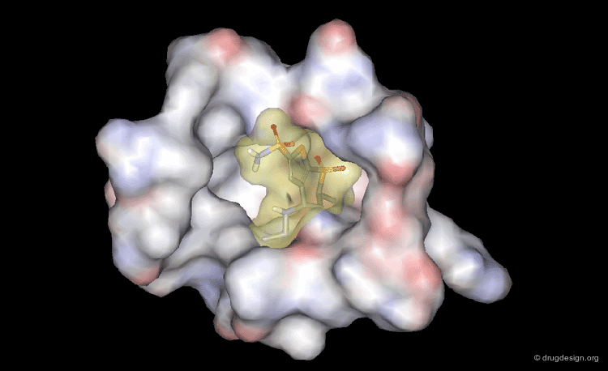

# Learning Objectives

1. Familiarise yourself with the basic concepts of proteins, small molecules, and their interaction physics.
2. Learn how to visualise the 3D structures of proteins and small molecules and how such structures are obtained.
3. Dock a small molecule into a protein binding site and score the interaction with AutoDock Vina.
4. Critically evaluate the results of a docking experiment and understand the limitations of docking.

# Part 1: Proteins, Small Molecules and their Interaction Physics

To understand the principles of drug discovery, it is important to understand the basic concepts of proteins, small molecules, and their interaction physics. Proteins are large biomolecules that perform a wide range of functions in living organisms, including catalyzing biochemical reactions, providing structural support, and regulating cellular processes. Therefore, they are the main targets for drug development. Small molecules, on the other hand, are low molecular weight compounds that are small enough to penetrate cell membranes and interact with proteins to modulate their activity. Therefore, small molecules are the main type of drugs used in modern medicine. 

::: {.callout-tip title="Self-Study: Proteins" collapse="true"}
1. Review how proteins are built from an **amino acid sequence**, how they fold into primary, secondary, tertiary and quaternary structures, and how their structure determines their function. 
2. Read about how the 3D structures of proteins are determined experimentally (e.g., X-ray crystallography, NMR spectroscopy) or predicted computationally (e.g. 2021 Breakthrough Paper [AlphaFold2](https://www.nature.com/articles/s41586-021-03819-2)).
:::

::: {.callout-tip title="Self-Study: Small Molecules" collapse="true"}
1. Review how drug-like small molecules are built from atoms, of which atoms they are composed and what functional groups they contain. Describe what makes a good drug-like small molecule (See [Lipinski's Rule of Five](https://en.wikipedia.org/wiki/Lipinski%27s_rule_of_five)).
2. Understand how small molecules can interact with proteins through various mechanisms, such as binding to active sites or allosteric sites.
3. Read about how small molecules can be represented in text format (e.g. Simplified Molecular-Input Line-Entry System [SMILES](https://en.wikipedia.org/wiki/Simplified_molecular-input_line-entry_system)).
:::


## How to visualise proteins, small molecules and their interactions
Structural bioinformaticians often use [PyMOL](https://pymol.org/2/) to visualise the 3D structures of proteins and small molecules. PyMOL is a powerful molecular visualization tool that allows users to manipulate and analyze molecular structures in three dimensions. It can be used to visualize protein-ligand interactions, identify binding sites, and generate publication-quality images of molecular structures.

::: {.callout-note title="Task: Visualizing 3D Structures" collapse="true"}
1. Apply for a free student license of PyMOL at <https://www.pymol.org/buy.html>
2. Download and install PyMOL on your computer.
3. Use PyMOL to visualise the 3D structure of a protein-ligand complex of your choice. You can obtain the 3D structure from the Protein Data Bank (PDB) by searching for a specific protein or ligand and downloading the corresponding PDB file. Once you have the PDB file, you can open it in PyMOL and explore the protein-ligand interactions.
4. Alternatively, you can directly fetch the 3D structure of a protein-ligand complex from the PDB using the PDB ID (e.g., 1OXR) in PyMOL by running the command `fetch 1OXR` in the PyMOL command line.
5. Familiarise yourself with the basic functions of the PyMOL interface, such as rotating, zooming, and changing the representation of the molecules.
    - At the bottom right, you can toggle on the sequence viewer (S), which shows the amino acid sequence of the protein and allows you to select specific residues by clicking on them. It also shows the ligand(s) in the structure, as well as potential water molecules and ions.
    - You can select different parts of the protein or ligand by clicking on them in the PyMOL interface, which creates a selection (sele).
    - On the right side of the PyMOL interface, you can find the "Display" menu, which allows you to show (S) or hide (H) different representations, such as hiding the cartoon representation and instead showing the stick representation. You can also toggle on the display of an approximated surface. 
    - These operations can be performed across the entire structure (all), on a specific part of the structure (e.g. 1OXR) or on the current selection (sele).
:::


::: {.callout-important title="Self-check: HIV Protease" collapse="true"}
Use PyMOL to visualise the 3D structure of a HIV protease-ligand complex (3O9I). Note that the protein is a homodimer, meaning it consists of two identical subunits. The ligand is a small molecule inhibitor that binds to the active site of the protease in between the two subunits. Use PyMOL to explore the protein-ligand interaction. Select the two protein chains in the sequence viewer and toggle on the surface view to see how the ligand fits into the active site.
:::

## Protein-Ligand Interaction Physics
Small molecule drugs generally work by binding to a specific protein target and modulating its activity. This binding is mediated by a combination of **non-covalent** interactions, meaning there are no covalent bonds formed between the protein and the small molecule. The interactions include:

- hydrogen bonding
- van der Waals forces
- electrostatic interactions (potentially involving ions)
- hydrophobic interactions
- pi-pi stacking interactions
- cation-pi interactions
- water-mediated interactions

Understanding these interactions is crucial for designing effective drugs. The more interactions a small molecule can form with a protein, the stronger the binding affinity will be. There are tools that can predict the non-covalent interactions between a protein and a small molecule from their 3D structures, such as [PLIP](https://plip-tool.biotec.tu-dresden.de/plip-web/plip/index).

::: {.callout-tip title="Self-Study: Non-Covalent Interactions" collapse="true"}
1. Briefly read about the different types of non-covalent interactions and when they are formed
:::

::: {.callout-note title="Task: Visualizing 3D Structures" collapse="true"}
1. Use the [PLIP](https://plip-tool.biotec.tu-dresden.de/plip-web/plip/index) tool to analyze the non-covalent interactions between a protein and a small molecule of your choice. On the website, you can directly enter the PDB ID of a protein-ligand complex from the Protein Data Bank (e.g. 1OXR, or 3O9I).
2. You can download the PLIP results as a PyMOL session for each small molecule in the structure. You can then open the PyMOL session to visualize the non-covalent interactions between the protein and the small molecule.
3. Note that the HIV-protease inhibitor in 3O9I forms a water bridge with a water molecule in the active site of the protease. This water-mediated interaction is important for the binding affinity of the inhibitor, stabilizing the interaction and lowering its overall energy.
:::


## Summary Part 1:
You have learned about the basic concepts of proteins, small molecules, and their interaction physics. You have also learned how to visualise the 3D structures of proteins and small molecules and how such structures are obtained. You have studied how to analyze the non-covalent interactions between a protein and a small molecule using the PLIP tool.


::: {.callout-important title="Self-check: 3D Structures" collapse="true"}
Why is the 3D structure of a protein important for drug design? Think about why it is important to know the 3D structure of a protein when designing drugs that target it. Why do models that predict the binding affinity of a small molecule to a protein usually rely on the 3D structure of the protein-ligand interaction? What speaks against using the protein sequence and the small molecule string representation (e.g., SMILES) as input for such models?
:::

::: {.callout-important title="Self-check: What makes a good small-molecule drug?" collapse="true"}
You have read about the general properties of small molecules that make them good drug candidates and also about the non-covalent interactions that are important for protein-ligand binding. Summarise the properties of a good small-molecule drug that binds to a specific protein target with high affinity: Can you see a trade-off?
:::


# Part 2: Docking a Small Molecule into a Protein Binding Site
Docking is a computational method that predicts the preferred orientation of a small molecule when it binds to a protein target structure. It takes a small molecule and a protein structure as input and generates a set of possible binding poses for the small molecule in the protein binding site. In this process, the small molecule is treated as a flexible ligand that can rotate, translate, and adopt different conformations, while the protein is usually treated as a rigid receptor (protein atoms cannot move and are fixed in space). The docking algorithm then evaluates each pose based on a scoring function that estimates the binding affinity. This affinity is represented by an energy value in kcal/mol, where lower values mean the pose has higher affinity (is more stable due to its low energy). The output of a docking experiment is a ranked list of poses, with the highest-scoring pose being the most likely binding mode.



## Docking aspirin into phospholipase A2
In this section, we will perform a docking experiment using AutoDock Vina to dock the small molecule drug aspirin into the binding site of the protein phospholipase A2. We will use the 3D structures of the protein and a 2D representation of the small molecule as input for the docking experiment. As we know the true binding site and conformation of aspirin in phospholipase A2 from crystallization studies, we can compare the docking results to the known binding mode and evaluate the accuracy of the docking experiment (if it has found the correct binding pose of aspirin in phospholipase A2).

**AutoDock Vina** ([Paper](https://pmc.ncbi.nlm.nih.gov/articles/PMC3041641/)) is a popular open-source docking software that docks small molecules to a protein binding site. It explores the conformational space of small molecules (flexible ligands) to find the most favorable binding poses within a protein binding site (rigid). It also uses a scoring function to predict the binding affinity of each pose.


## Step 1: Create a dedicated docking environment
In order to gather all the necessary tools for docking, we will create a dedicated conda environment. This will ensure that all dependencies are installed and that the tools do not interfere with other software on your system.

```bash
# Create a dedicated environment
conda create -n docking_env python=3.10 -y
conda activate docking_env

# Install AutoDock Vina and OpenBabel via conda-forge
conda install -c conda-forge vina openbabel -y

# Install RDKit, SciPy and Gemmi via conda-forge
conda install -c conda-forge rdkit scipy gemmi -y

# Install Meeko for modern ligand preparation
pip install meeko
```
 **OpenBabel** is a chemical toolbox that can convert between different file formats and perform various chemical operations. **RDKit** is a cheminformatics library that provides tools for working with chemical structures and performing molecular modeling tasks. **Meeko** is a modern ligand preparation tool that can generate 3D conformations of small molecules and prepare them for docking. **Gemmi** is a library for working with crystallographic data, which can be useful for preparing protein structures for docking.

## Step 2: Download and Prepare the Protein (Receptor)
In this part, we will download the 3D structure of the protein phospholipase A2 in complex with aspirin from the Protein Data Bank (PDB) and prepare it for docking. We will extract only the protein from the complex and convert it to the PDBQT format, which is required by AutoDock Vina.
The Protein Data Bank (PDB) is a public database of protein structures derived from crystallographic studies. 

1. **Download the Protein:**
    - Go to the RCSB Protein Data Bank entry for the structure of the interaction ([here](https://www.rcsb.org/structure/1OXR))
    - Go to *Download Files* > *Legacy PDB* 
    - Save the file as `1OXR.pdb`. This file contains the 3D coordinates of the protein-ligand complex, including the protein, the ligand (aspirin), water molecules, and ions.

2. **Extract only the protein from the complex.**
    - Open the complex in PyMOL
    - Remove water molecules by clicking on the "A" button next to the "all" in the display menu and select "remove waters"
    - Remove the ligand by selecting it, then click on the "A" button next to the "sele" in the display menu and select "remove atoms"
    - Only the protein chain and an ion remain. Save this structure as the receptor
        - *File* > *Export Molecule* > *Save*
        - select PDB as the file type and call the file `receptor.pdb`.

3. **Convert the PDB into PDBQT for Docking:** 
    - Open a terminal at the location of the `receptor.pdb` file 
    - Run ```obabel receptor.pdb -O receptor.pdbqt -xr -h``` to convert the protein to PDBQT format for docking (make sure the docking_env is activated).
    
        

## Step 3: Download and Prepare the Small Molecule (Ligand)
In this part, we will download a 2D representation of the small molecule drug aspirin from PubChem and prepare it for docking. We will convert the downloaded SDF file into the PDBQT format, which is required by AutoDock Vina. A 2D representation of the small molecule is sufficient for docking, as AutoDock Vina simulates the flexibility of the ligand and will generate 3D conformations of the ligand during the docking process. PubChem is a public database of chemical compounds and their properties. 

1. **Download a simple 2D representation of aspirin from PubChem** 
    - Find aspirin in the PubChem database ([here](https://pubchem.ncbi.nlm.nih.gov/compound/2244)) 
    - Go *Download* > *2D Structure* and save the SDF file as `aspirin.sdf` next to the `receptor.pdb` file.

2. **Convert the SDF file into PDBQT format for docking:**
    - Open a terminal at the location of the `aspirin.sdf` file and run the command ```mk_prepare_ligand.py -i aspirin.sdf -o aspirin.pdbqt```. This will convert the SDF file into PDBQT format for docking (make sure the docking_env is activated).


## Step 4: Define the Docking Box
Now that we have prepared the protein and the small molecule, we need to define the docking box. The docking box is a 3D region around the binding site of the protein where AutoDock Vina will search for possible binding poses of the small molecule. The docking box is defined by its center coordinates (x, y, z) and its size (width, height, depth). As we know the true binding site of aspirin in phospholipase A2, we can use PyMOL to find the center of the binding site and define the docking box around it. We can then see if AutoDock Vina can find the correct binding pose of aspirin in the docking box.

- Open the original complex 1OXR in PyMOL and select the ligand by clicking on it
- In the PyMOL console below the sequence viewer, type `pseudoatom center, sel`
- A small star will appear at the center of the ligand (pseudoatom), which we will use as the center of our box
- Deselect the ligand and select the pseudoatom
- In the PyMOL console, type `xyz = cmd.get_coords('sel')` followed by `print(xyz)`. This will print the coordinates of the pseudoatom, which is the center of our box. Note down the rough values of these coordinates, as you will need them to define the docking box for AutoDock Vina.

For testing purposes we will use a docking box of size 20x20x20 Å, which is large enough to cover the binding site and allow for some flexibility in the docking process. The size of the docking box can be adjusted based on the size of the ligand and the binding site. You could even make it so large that it includes the entire protein, which would allow AutoDock Vina to search for binding poses anywhere on the protein surface. However, this would also increase the computational time and reduce the accuracy of the docking results, as AutoDock Vina would have to explore a much larger conformational space.


## Step 5: Docking aspirin into phospholipase A2
Now that we have prepared the protein and the small molecule and defined the center of our docking box, we can run AutoDock Vina to dock the small molecule into the protein binding site. Open a terminal at the location of the prepared files and run the following command, replacing `<X>`, `<Y>`, and `<Z>` with the coordinates of the center of the docking box that you obtained from PyMOL:

```bash
vina --receptor receptor.pdbqt --ligand aspirin.pdbqt --center_x <X> --center_y <Y> --center_z <Z> --size_x 20.0 --size_y 20.0 --size_z 20.0 --out docking_results.pdbqt --exhaustiveness 32
```

If successful, this prints a table with the docking results, including the binding affinity (in kcal/mol). The pose with the highest binding affinity is the one with the lowest kcal/mol energy value. The docking poses will be saved in the `docking_results.pdbqt` file. We will convert this file into SDF format for easier visualization in PyMOL. Run the following command to convert the docking results into SDF format:

```bash
obabel docking_results.pdbqt -O docking_results.sdf
```

## Step 6: Visualize the Docking Results
Now that we have obtained the docking results, we can visualize them in PyMOL. Open the original complex 1OXR in PyMOL and load the docking results by drag-and-dropping the `docking_results.sdf` file into the same PyMOL window. You can then compare the docking poses with the true binding pose of aspirin in phospholipase A2. The `docking_results.sdf` file contains multiple poses of the small molecule. You can switch between them by clicking on the arrows and play symbol at the bottom right of the PyMOL window.


## Summary Part 2: 
You have learned how to dock a small molecule into a protein binding site using AutoDock Vina. You have prepared the protein and the small molecule for docking, defined the docking box, and run the docking experiment. You have also visualized the docking results in PyMOL and compared them with the true binding pose of the small molecule in the protein binding site.

::: {.callout-note title="Task: Experimenting with AutoDock Vina" collapse="true"}
If your docking experiment was not able to find the correct binding pose of aspirin in phospholipase A2, you can try to adjust the docking parameters and run the docking experiment again. You can try to change the size of the docking box, the exhaustiveness of the search, or the number of binding poses to generate. You can also 
try to dock a different small molecule into the same protein binding site or a different protein-ligand complex.
Here an overview of the most important parameters of AutoDock Vina:

- `--receptor`: The path to the prepared protein file in PDBQT format.
- `--ligand`: The path to the prepared small molecule file in PDBQT format
- `--center_x`, `--center_y`, `--center_z`: The coordinates of the center of the docking box
- `--size_x`, `--size_y`, `--size_z`: The size of the docking box in Ångströms
- `--out`: The path to the output file where the docking results will be saved in PDBQT format
- `--exhaustiveness`: The number of independent runs that AutoDock Vina will perform to explore the conformational space of the ligand. A higher value increases the accuracy of the docking results but also increases the computational time.
- `--num_modes`: The number of binding poses to generate. The default is 9.
:::


::: {.callout-important title="Self-check Question:" collapse="true"}
You have experienced the precision of AutoDock Vina in docking a small-molecule drug into a protein binding site. Are you convinced that this tool is useful for drug discovery? Imagine you have a new protein target that is associated with cancer and you want to find a small molecule that can bind to it and inhibit its activity. You could download any small molecule from PubChem or similar databases to build your own small-molecule drug candidate library. Then you let AutoDock Vina dock the molecules in your library against the protein target and you select the one that has the best binding affinity (lowest energy). Do you think you will be able to pick the best small molecule from your library that binds to the protein target?
:::


While AutoDock Vina is highly regarded for its redocking capability (finding the correct binding pose of a known ligand in a known protein binding site within the standard 2Å RMSD threshold of allowed deviation), its precision heavily depends on the flexibility of the ligand and the nature of the binding pocket. In a real drug discovery campaign, Vina's exceptional speed makes it a useful tool for primary virtual screening to rapidly filter out non-binders from huge libraries of drug candidates (for example those that don't fit into the protein's binding pocket). However, the following limitations should be kept in mind:

- The predicted poses should always be viewed as computational suggestions rather than definitive answers. This is perfectly illustrated by the fact that you can command Vina to output virtually any number of alternative binding modes simply by changing the `--num_modes` parameter. 

- AutoDock Vina might give out poses even if the ligand does not bind in reality. This is because the scoring function used by AutoDock Vina is a simplified model of the protein-ligand interaction and does not always accurately reflect the true binding affinity of the small molecule to the protein. Therefore, it is important to validate the docking results with experimental data or more accurate computational methods, such as molecular dynamics simulations or free energy calculations.

- AutoDock Vina regards the protein as a rigid structure, which is not always the case in reality. Proteins are dynamic molecules that can undergo conformational changes upon ligand binding, which can affect the binding affinity and pose of the small molecule. In our example, we took the protein structure from a crystal structure of the protein-ligand complex, which is already in the correct conformation, ready to bind aspirin. However, in many drug discovery projects, the protein is flexible and might change its conformation upon ligand binding. If the protein structure is obtained from a crystal structure of the apo form of the protein (without ligand), from a homology model (guessing the structure based on a similar known structure), or from AlphaFold (AI model to predict protein structures from amino acid sequences), the resulting structure does not reflect the true binding site conformation. In this case, AutoDock Vina cannot find the correct binding pose of the small molecule in the protein binding site, even if the small molecule is a good binder.


Overall, AutoDock Vina is a useful tool, but its apparent limitations limit its usability in real drug discovery. So there is still a great need for more accurate and reliable docking methods and more accurate binding affinity prediction models to accelerate small-molecule drug discovery. 